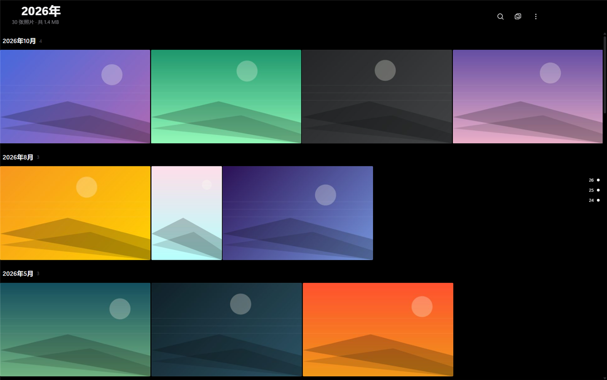
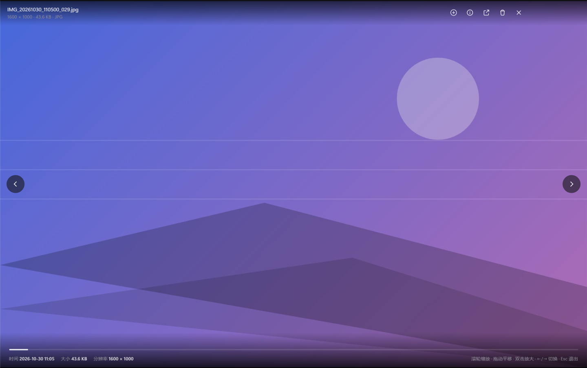
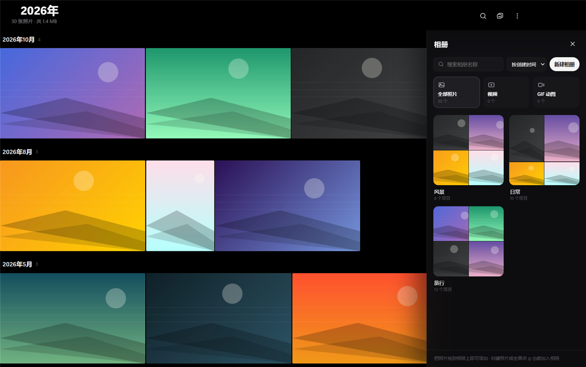
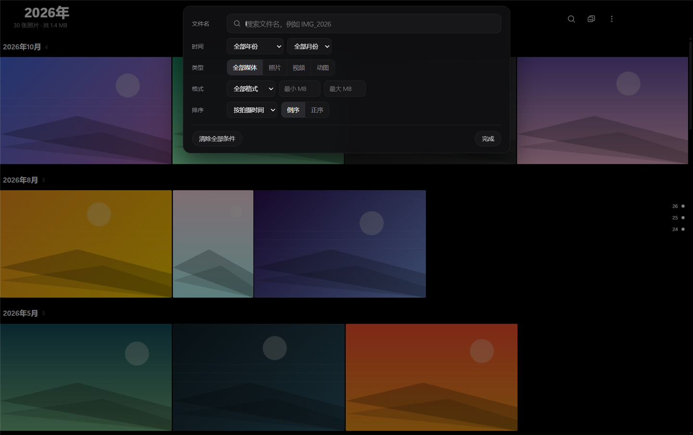
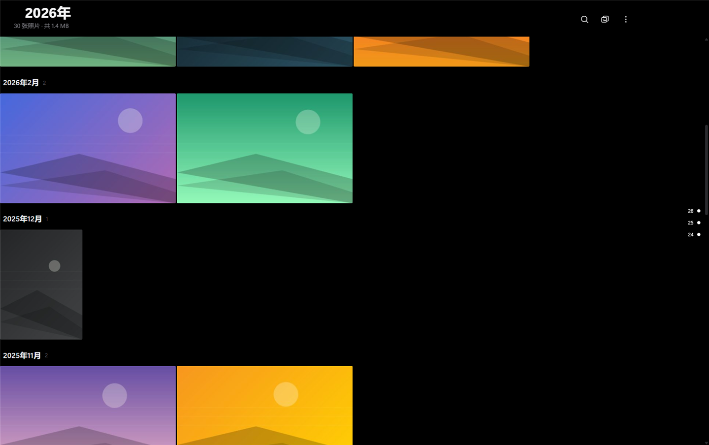

# Album · Windows 桌面仿手机相册

纯黑 AMOLED 风格的本地相册，界面参考安卓手机相册：顶部年份、照片与视频混排的密集照片墙、全屏沉浸查看、年份/月份时间轴。
所有媒体只在本机读取与索引，不上传网络，不修改、不压缩原图与原视频。

## 截图

| 照片墙 | 全屏查看 |
| --- | --- |
|  |  |

| 相册分类 | 搜索与筛选 |
| --- | --- |
|  |  |



> 截图使用本地生成的演示照片，不含任何个人图片。

## 安装包（多架构）

安装包已上传到 [Releases · v1.0.0](https://github.com/173433540/Album/releases/tag/v1.0.0)，直接点击文件名下载；也可以按下面的命令自行构建：`npm run dist:x64`、`dist:x86`、`dist:arm64`，输出目录见 `package.json` 的 `build.directories.output`。

| 安装包 | CPU 架构 | 适用系统 | 大小 | 实测情况 |
| --- | --- | --- | --- | --- |
| [`Album_Windows_x64_Setup.exe`](https://github.com/173433540/Album/releases/download/v1.0.0/Album_Windows_x64_Setup.exe) | x64 | Windows 10 / 11 64 位（Intel、AMD） | 91.0 MB | 已安装并运行通过 |
| [`Album_Windows_x86_Setup.exe`](https://github.com/173433540/Album/releases/download/v1.0.0/Album_Windows_x86_Setup.exe) | x86（32 位） | Windows 10 32 位 | 85.8 MB | 已安装并运行通过（WOW64） |
| [`Album_Windows_ARM64_Setup.exe`](https://github.com/173433540/Album/releases/download/v1.0.0/Album_Windows_ARM64_Setup.exe) | ARM64 | Windows 11 ARM64 | 87.0 MB | 已构建，未实机运行（见下） |
| [`Album_Windows_AutoSetup.exe`](https://github.com/173433540/Album/releases/download/v1.0.0/Album_Windows_AutoSetup.exe) | 自动识别 | 全部 | 203 KB | 已运行验证识别结果 |

**自动检测安装**：把四个 exe 放在同一个文件夹，双击 `Album_Windows_AutoSetup.exe`（本机文件名是 `Album_Windows_自动检测安装.exe`）。它会读取系统版本与原生 CPU 架构（`IsWow64Process2`），选择对应安装包并弹窗确认；找不到匹配安装包或系统低于 Windows 10 时给出明确提示，不会强行安装。

**安装与卸载**：双击安装包 → 选择安装目录（默认当前用户目录，无需管理员）→ 完成。桌面和开始菜单会生成「Album」快捷方式；卸载程序在安装目录里的 `Uninstall Album.exe`，卸载不会删除 `%APPDATA%\PhotoAlbum` 里的索引与设置。

**架构校验**：ARM64 包在非 ARM64 设备上会提示并退出；x86 包在 64 位系统上会提示建议改用 x64 版本（可继续安装）；x64 包在 32 位系统上拒绝安装。三个包共用同一 appId，安装另一架构会替换现有安装，不会并存。

**测试环境**：Windows 11 Build 26200 x64。x64 与 x86 两个安装包均完成静默安装、启动、索引扫描、GIF 动画、视频播放、卸载全流程；1.0.0 安装包于 2026-11-07 重新构建并验证了静默安装、启动、内置文件夹浏览、添加并扫描、卸载。x86 版以 WOW64 方式在此机器运行，未在真实 32 位 Windows 10 机器上执行；ARM64 包因本机为 x64 无法执行 ARM64 二进制，只做了构建与包内 `Album.exe` 的 PE 架构校验（`0xAA64`）。Windows 10 兼容性依据 Electron 38 的官方支持范围，未做实体机测试。

**未签名提示**：安装包没有代码签名证书，首次运行可能出现 SmartScreen 提示（更多信息 → 仍要运行）。

**FFmpeg**：本项目不依赖外部 FFmpeg。视频解码使用 Electron 随包分发的 `ffmpeg.dll`，每个架构的安装包里各带一份，无需用户另外安装。

## 直接使用（免安装，x64）

便携版同样在本地打包（`npm run pack`，产物在 `dist/Album`）：

```
dist\Album\Album.exe
```

双击运行 → 点右上「更多」→「添加文件夹…」（或首次启动的提示按钮）→ 在软件内置的文件夹浏览器里进入目录、预览图片，再点「添加此文件夹」，等待扫描完成即可。
添加后可在「更多 → 文件夹…」里查看所有已添加的文件夹、单独重扫或移除；点击某个文件夹的「查看」即可只看该文件夹里的照片和视频。
整个 `Album` 文件夹可整体复制到任意位置或 U 盘，`Album.exe` 即程序入口。便携版只提供 x64。

## 从源码运行

需要 Node.js 22 或更高（本项目使用 Electron 38 内置的 `node:sqlite`，无需编译原生模块）。

```bash
cd C:\AI\PhotoAlbum
npm install
npm start
```

## 打包

### 便携版（无需联网下载打包工具，推荐）

```powershell
cd C:\AI\PhotoAlbum
powershell -NoProfile -ExecutionPolicy Bypass -File build-portable.ps1
```

脚本会：复制 `node_modules\electron\dist` → 改名为 `Album.exe` → 把 `main / renderer / assets / package.json` 放进 `resources\app` → 用
`C:\AI\_tools\rcedit\rcedit.exe` 写入图标与版本信息。产物在 `C:\AI\Album\Album`。
若本机没有 rcedit，脚本会跳过图标写入，程序功能不受影响。

### 安装包（NSIS，多架构）

```bash
npm install
npm run dist:x64     # Album_Windows_x64_Setup.exe
npm run dist:x86     # Album_Windows_x86_Setup.exe
npm run dist:arm64   # Album_Windows_ARM64_Setup.exe
```

产物在 `C:\AI\Album\`（`build.directories.output` 已指向该目录）。首次构建需要下载各架构的 Electron 运行时与 NSIS 工具；国内网络可先设置镜像：

```powershell
$env:ELECTRON_MIRROR = "https://npmmirror.com/mirrors/electron/"
$env:ELECTRON_BUILDER_BINARIES_MIRROR = "https://npmmirror.com/mirrors/electron-builder-binaries/"
```

安装前的架构校验写在 `build\installer.nsh`；自动检测安装程序源码在 `tools\auto-setup.cs`（用 .NET Framework 的 `csc.exe` 编译）。

## 功能

**启动动画**

- 纯黑全屏背景，软件图标居中显示（约占窗口宽度 12%）。
- 荧光蓝、紫、玫红、绿、黄、橙等彩色笔触从图标下方起笔，沿 N 形折线向上，再围绕图标快速交错涂画，最后在中央快速划过，把图标完全盖住后与黑色背景一起淡出，进入相册主界面。

**照片墙**

- 自动递归扫描所选文件夹（含子文件夹），图片支持常见格式以及 HEIC / HEIF / AVIF / TIFF / SVG / ICO / JPEG XL 和常见相机 RAW（DNG、CR2、CR3、NEF、ARW、ORF、RW2、RAF、PEF、SRW 等）；视频支持 MP4 / M4V / MOV / QT / AVI / MKV / WEBM / WMV / ASF / FLV / F4V / MPG / MPEG / MPE / MPV / M1V / M2V / M2P / M2T / M2TS / MTS / TS / TP / TRP / 3GP / 3G2 / 3GPP / 3GPP2 / OGV / OGM / RM / RMVB / RV / VOB / DIVX / XVID / MXF / DV / WTV / MOD / TOD / SVI / H264 / H265 / IVF / MJPG 等，可加多个文件夹。扩展名不区分大小写。
- GIF / APNG 动图按图片处理：缩略图取首帧，左下角带 `GIF` / `APNG` 小标识，点开在查看器里按原速循环播放动画。
- 照片和视频在同一个照片墙里按时间混排（参考安卓原生相册），不分成两个页面；视频缩略图取系统解码出的真实画面，中央叠加白色 ▶ 三角，右下角显示时长（如 `02:35`），照片不显示这两个标识。
- 按拍摄时间排序：优先读 JPEG/TIFF/DNG 的 EXIF `DateTimeOriginal`，视频与缺失 EXIF 的图片回退文件修改/创建时间。
- 点击照片打开全屏图片查看器，点击视频直接打开内置播放器（原生控件、支持拖动进度）；两者不会互相误入。
- 虚拟滚动 + 懒加载：只渲染视口附近的单元格，几万张照片也能流畅滚动；缩略图本地磁盘缓存（LRU 上限 3 GB）。
- 无限加载：向下滚动自动续载，不翻页。
- 按月自动分组显示（如「2026年9月 4」），缩略图保持原始比例，间距 2px。
- 照片墙缩放：`Ctrl` + 滚轮上下滚动，整墙缩略图连续放大/缩小，每行数量自动增减；普通滚轮仍是滚动浏览，按住中键上下拖动也能滚动，页面上没有缩放按钮。

**顶部栏**

- 左侧年份标题（2026年），`‹ ›` 切换年份。
- 右侧：搜索、相册、更多菜单；下方一行统计「45 个项目 · 照片 43 · 视频 2 · 共 47.2 MB」。

**搜索与筛选**

- 文件名关键字、年份、月份、格式、大小区间、排序字段（拍摄/修改/文件名/大小）、正序倒序、媒体类型（全部媒体 / 照片 / 视频 / 动图）。
- 条件以标签（chips）展示，可单独移除或一键清空，结果实时刷新。

**相册分类**

- 顶部相册按钮（`Ctrl + B`）打开右侧相册抽屉：智能分类「全部照片 / 视频 / GIF 动图」加自定义相册，每个相册显示封面、名称、项目数和缩略图预览。
- 新建、重命名、更换封面、删除相册；删除只清分类关系，绝不删除原始文件。
- 把照片 / 视频 / 动图加入相册：照片墙直接拖到相册卡片上、右键「添加到相册…」、全屏查看时点右上角 ⊕，或在「更多 → 批量选择…」里多选后一次加入。
- 同一张照片可以同时属于多个相册；在相册视图里右键「从当前相册移除」，只移出分类，原文件仍在。
- 只保存索引关系（SQLite `albums` / `album_items`），不复制文件；重启软件后相册、封面和分类关系完整保留。
- 相册名支持即时搜索，可按创建时间 / 名称 / 数量排序。

**时间轴**

- 左侧浮层按年份 > 月份列出所有有项目的月份，点击直接定位；空月份不显示。定位只改变浏览位置，不再把更新的照片过滤掉，向上滚动会继续加载定位点之前的照片。

**全屏查看**

- 纯黑背景、原图渲染（`photo://` 协议直读原文件，非缩略图），保持比例居中。
- 浏览器无法直接解码的格式（HEIC / TIFF / RAW / PSD / JXL 等）自动切换到系统解码器生成的预览图（`preview://`，最长边 2048），信息栏标注「预览图」。系统也没有解码器时提示格式名，按 Enter 用系统看图器打开。
- 滚轮缩放（1–8 倍）、拖动、双击 1×↔2.4×、左右键切换、Esc 退出、底部显示序号 `125/2300` 与文件名/大小/分辨率。
- 切换时预加载相邻图片并带过渡动画；工具栏鼠标静止 2.4 秒后自动隐藏。

**视频播放**

- 点击照片墙里的视频进入全屏播放器，`video://` 协议支持 Range 请求，可以随意拖动进度条，原文件直读不转码。
- `Esc` 关闭并停止播放，空格暂停/播放；播放失败（编码不受支持）时显示提示，右键「用系统播放器打开」可交给系统。
- 视频时长在首次显示时自动测量并写入索引，之后直接读取。

**管理**

- 删除（`Delete`，二次确认，移入回收站）、复制路径、复制图片、在资源管理器中显示、用系统看图器/播放器打开原文件。
- 照片墙支持把缩略图直接拖进相册抽屉里的相册卡片；右键菜单可「添加到相册…」，在相册视图里还可「从当前相册移除」。
- 「更多 → 批量选择…」进入多选模式，勾选多个照片/视频/动图后一次加入同一相册。
- 「更多 → 添加文件夹…」打开软件内置的文件夹浏览器：从盘符开始逐级进入子文件夹，直接看缩略图、点开看大图，确认后再「添加此文件夹」并扫描，不用先知道完整路径。
- 「更多 → 文件夹…」列出所有已添加的文件夹及其项目数、视频数，可对单个文件夹「查看 / 扫描 / 移除」；点「查看」后照片墙只显示该文件夹的内容，顶部出现「文件夹：xxx」标签，移除标签即回到全部。
- 主题切换：「更多 → 切换到浅色主题 / 切换到深色主题」，两种配色即时生效并记住选择；全屏看图与视频播放器在两种主题下都保持纯黑背景。
- 记住上次窗口大小/位置/最大化状态、上次打开的文件夹、排序与筛选偏好。
- 缩略图缓存可在「更多 → 清空缩略图缓存」清理。
- 「更多 → 关于」查看软件说明与授权声明。

## 授权声明

本项目依据 MIT 许可协议开源，可免费使用、复制、修改、分发，也可用于商业用途；分发本软件或其修改版本时必须保留原始版权声明。本软件按现状提供，不提供任何担保；使用风险与本地图片版权由使用者自行承担，禁止用于违法、侵权场景。安装包许可证页显示完整协议，仓库内 `LICENSE.txt` 为软件许可协议，`LICENSE-MIT.txt` 为 MIT 官方英文文本。

## 快捷键

| 按键 | 作用 |
| --- | --- |
| `Ctrl + O` | 添加文件夹 |
| `Ctrl + F` | 打开搜索/筛选面板 |
| `Ctrl + B` | 打开 / 关闭相册抽屉 |
| `F5` | 刷新列表 |
| `Ctrl + ← / →` | 上一年 / 下一年 |
| `Home` / `End` | 滚动到顶 / 到底 |
| `Enter` | 查看选中照片 / 播放选中视频 |
| `Ctrl` + 滚轮 | 照片墙放大 / 缩小 |
| `←` / `→` | 查看器内上一张 / 下一张 |
| `Space` | 视频播放器暂停 / 播放 |
| `Esc` | 关闭面板 / 退出查看器或播放器 |
| `A` | 把当前照片加入相册 |
| `Delete` | 删除当前项目（需确认） |

## 数据位置

```
%APPDATA%\PhotoAlbum\
  library.db        SQLite 索引（路径、时间、尺寸、大小、类型、时长、收藏状态）
  thumbs\           缩略图缓存（按 SHA1 二级目录）
  previews\         系统解码器生成的预览图（HEIC / TIFF / RAW 等）
  settings.json     文件夹列表、窗口状态、排序与筛选偏好
```

设置环境变量 `PHOTOALBUM_DATA` 可改用自定义数据目录（便携/多库场景）。
删除该目录等于重置索引，原始文件不受影响。

## 项目结构

```
PhotoAlbum\
  main\
    main.js         主进程：窗口、菜单、自定义协议 thumb:// photo:// preview:// video://、全部 IPC
    preload.js      contextBridge 暴露 window.album.*
    config.js       数据目录与 settings.json 读写
    db.js           node:sqlite 建表、查询、时间轴聚合、批量写入、媒体类型与时长
    scanner.js      递归扫描（图片 + 视频）、增量更新、批量入库、进度事件
    thumbs.js       缩略图生成与磁盘缓存（LRU）、视频封面
    media.js        视频扩展名与 MIME 映射
    exif.js         JPEG EXIF 日期与各格式尺寸解析
  renderer\
    index.html      界面骨架
    css\app.css     纯黑主题与全部样式
    js\grid.js      虚拟化照片墙（justified 行布局 + 视口裁剪，视频角标）
    js\viewer.js    全屏图片查看器（缩放/拖动/切换）
    js\video.js     全屏视频播放器
    js\app.js       状态、搜索筛选、时间轴、菜单、快捷键、主题切换
    js\splash.js    启动涂鸦动画（SVG 笔触 + 时序）
    js\theme-boot.js 启动前应用上次选择的主题
  assets\           图标（app.ico / app-256.png）
  build\installer.nsh  安装前架构校验（ARM64 / x86 提示）
  tools\            测试图片生成器、EXIF 注入、图标生成、自动检测安装源码（auto-setup.cs）
  test\             扫描与界面验证脚本（开发用）
  build-portable.ps1  便携版打包脚本
```

## 已知限制

- HEIC / HEIF 需要 Windows 的「HEIF 图像扩展」（Win10 1809+ 可选组件，多数机器已装）；TIFF / BMP / RAW / PSD 走 Windows 系统解码器。系统缺解码器的文件仍会出现在照片墙，显示格式占位，按 Enter 可用系统看图器打开。
- 视频播放使用 Electron 内置的 Chromium 解码能力：H.264 / VP8 / VP9 / AV1 / Theora + AAC/MP3/Opus/Vorbis 可直接播放；HEVC(H.265)、RMVB、部分 WMV/MKV 视系统与编码而定，无法解码时播放器会提示，可右键「用系统播放器打开」。视频封面由 Windows 缩略图服务提取，缺少对应解码器时显示格式占位（仍保留 ▶ 与时长，点开照样能进播放器）。
- 首次扫描大目录（数万张）需要时间，用于读取 EXIF、生成缩略图与视频封面；再次扫描为增量，速度快很多。
- 安装包提供 x64、x86、ARM64 三种架构，仅支持 Windows 10 / 11；便携版只有 x64。ARM64 安装包尚未在 ARM64 实机验证。